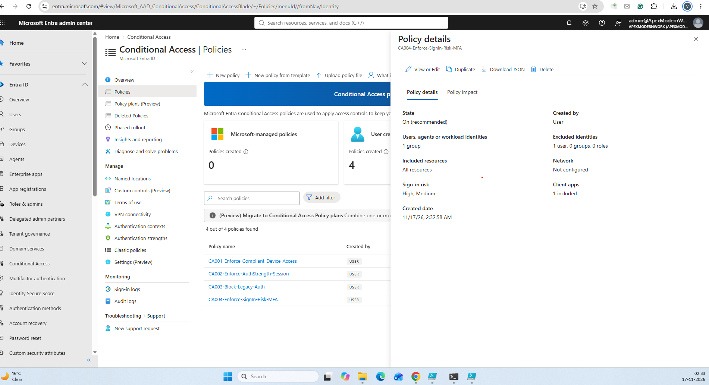
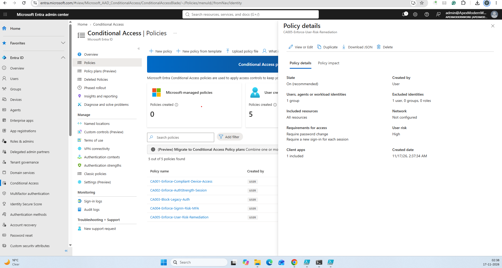
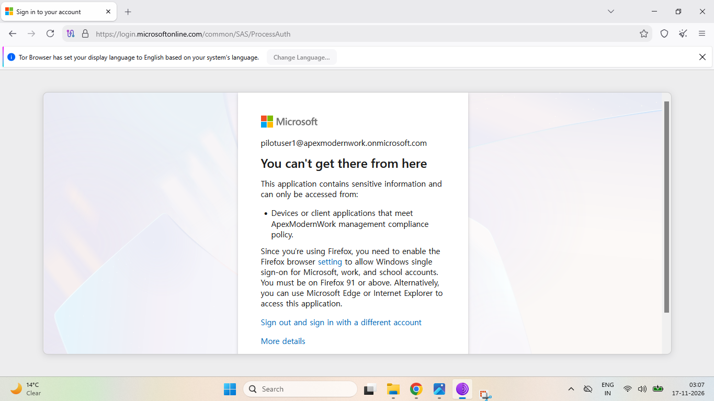
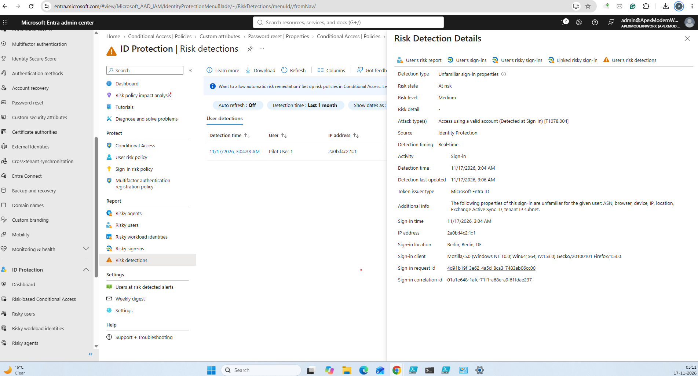
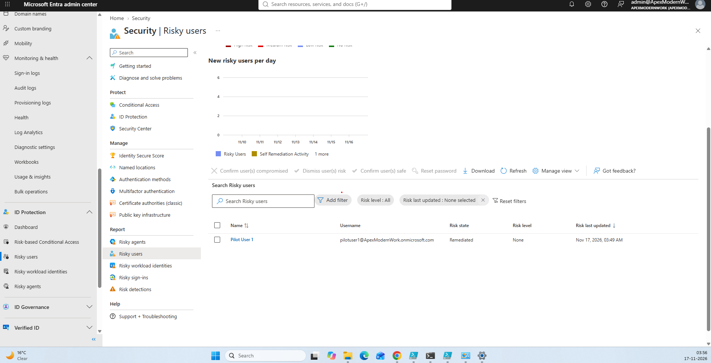
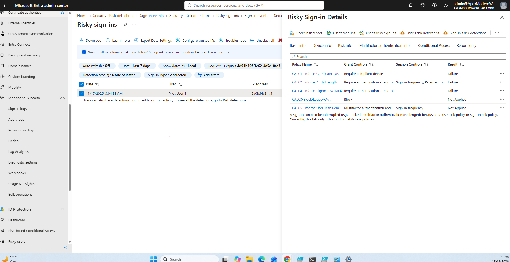

@'
# Microsoft Entra ID Protection: Risk-Based Conditional Access & Automated Remediation Lab

Enterprise identity threat detection, risk-based Conditional Access governance, and automated self-remediation lab built on **Microsoft Entra ID P2** and **Windows 11 Pro** (`TESTUSER-1`) within the `ApexModernWork.onmicrosoft.com` tenant.

## Architecture Overview

This lab implements real-time identity risk detection and automated access remediation without administrative intervention:

1. **Sign-In Risk Enforcement (`CA004-Enforce-SignIn-Risk-MFA`):** Configured real-time Conditional Access evaluation targeting **Medium** and **High** sign-in risks across all cloud applications for `SG-M365-Pilot-Devices-Users` (excluding break-glass administration), enforcing custom phishing-resistant Authentication Strength (`AS_PhishResistant_Pilot`).
2. **User Risk Remediation (`CA005-Enforce-User-Risk-Remediation`):** Configured Conditional Access policy targeting **High** user risk states, enforcing mandatory multifactor authentication and self-service password change (`Require password change` with every-time sign-in frequency) to automatically restore compromised accounts to a safe state.
3. **Anonymous IP & Unfamiliar Sign-In Simulation:** Simulated an anonymous Tor exit-node sign-in from Berlin (`2a0b:f4c2:1::1`) using `pilotuser1@ApexModernWork.onmicrosoft.com`, triggering real-time Entra ID Protection risk telemetry (`T1078.004` — Unfamiliar sign-in properties).
4. **End-to-End Risk Lifecycle & Audit Verification:** Confirmed user compromise in Entra ID Protection, executed automated self-service password reset remediation on `TESTUSER-1`, and verified the transition from `Confirmed compromised` to `Remediated` alongside layered Conditional Access evaluation logs.

---

## Lab Evidence & Artifacts

### 01. Risk-Based Conditional Access Policies (`CA004` & `CA005`)

* **#01 Sign-In Risk Policy (`CA004-Enforce-SignIn-Risk-MFA`):** Scoped to `SG-M365-Pilot-Devices-Users` (excluding break-glass admin), enforcing `AS_PhishResistant_Pilot` when **Medium** or **High** sign-in risk is detected.

* **#02 User Risk Remediation Policy (`CA005-Enforce-User-Risk-Remediation`):** Enforced mandatory password change and per-session reauthentication when **High** user risk is detected.

---

### 02. Risk Simulation, Detection Telemetry & Automated Remediation

* **#03 Anonymous Exit-Node Sign-In Simulation (`pilotuser1`):** Executed sign-in attempt through Tor Browser (`login.microsoftonline.com/common/SAS/ProcessAuth`), triggering real-time risk evaluation and Conditional Access enforcement.

* **#04 Entra ID Protection — Risk Detection Details:** Verified real-time detection of **Unfamiliar sign-in properties** (`Medium` risk level, MITRE ATT&CK `T1078.004`, Berlin exit node `2a0b:f4c2:1::1`, Request ID `4d91b19f-3e62-4a5d-8ca3-7483ab06cc00`).

* **#05 Risky Users Automated Remediation (`Remediated`):** Confirmed user compromise to elevate user risk to `High` and completed self-service password change via `CA005`, transitioning `pilotuser1@ApexModernWork.onmicrosoft.com` to **Risk state: Remediated** (`Risk level: None`).

* **#06 Risky Sign-In Log — Layered Conditional Access Evaluation:** Audited Request ID `4d91b19f-3e62-4a5d-8ca3-7483ab06cc00` confirming `CA004-Enforce-SignIn-Risk-MFA` evaluated alongside `CA001-Enforce-Compliant-Device` and `CA002-Enforce-AuthStrength-Session`.

'@ | Set-Content -Path .\README.md -Encoding UTF8

git add -A
git commit -m "Update README and sync all 6 lab screenshots"
git push -u origin main --force
